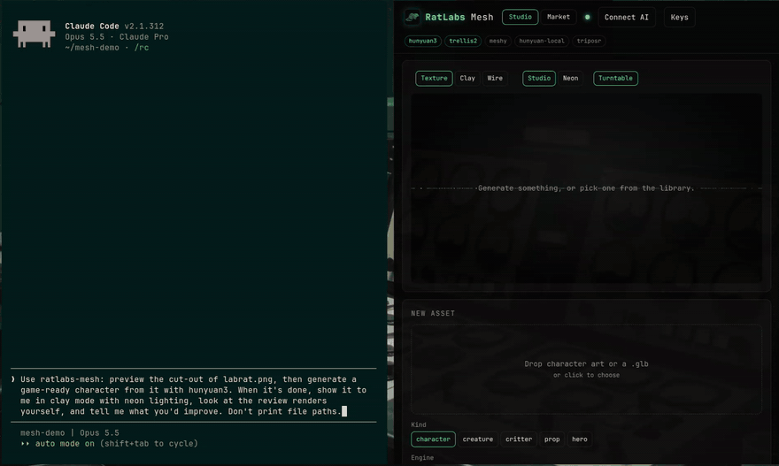
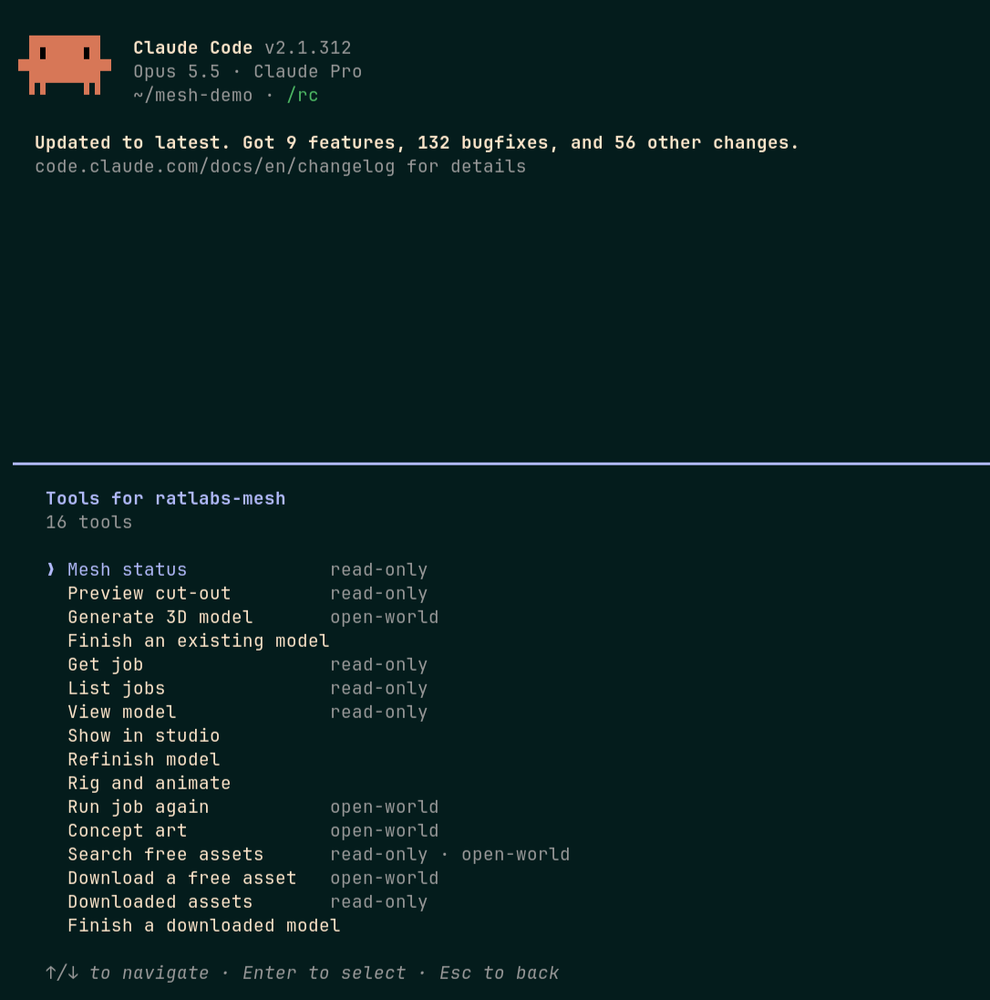
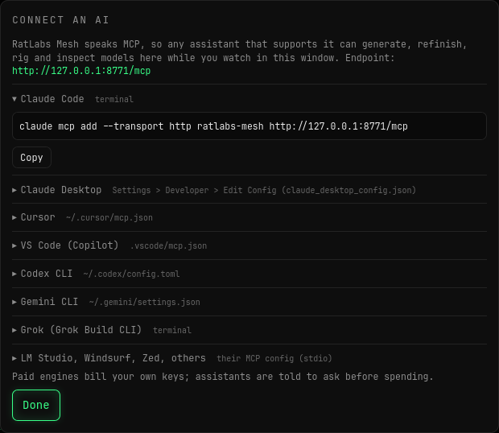
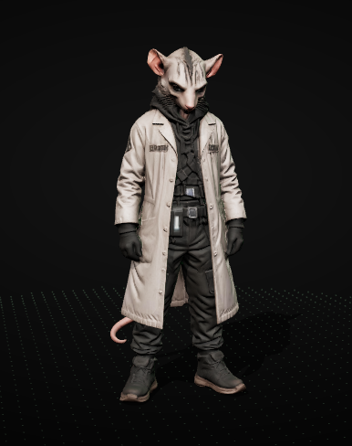
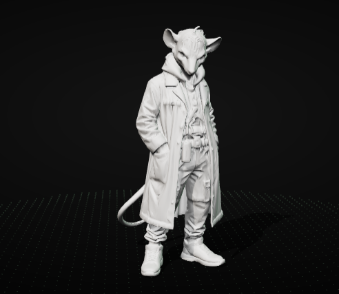
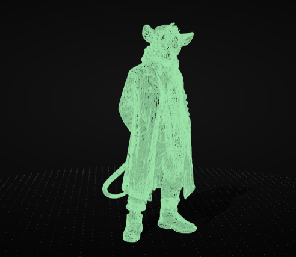
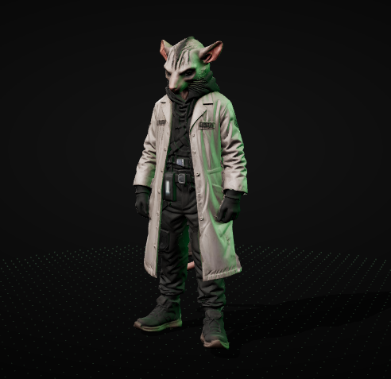

<p align="center"></p>

<h1 align="center">RatLabs Mesh</h1>

<p align="center"><b>Turn character art into finished, game-ready 3D models: by hand, or by asking any AI.</b><br>
Cut-out, 3D generation, cleanup, real-world sizing, review renders and auto-rigging in one local studio.</p>

<p align="center">
<a href="https://github.com/labrat-0/ratlabs-mesh/releases/latest"></a>
<a href="https://github.com/labrat-0/ratlabs-mesh/actions/workflows/ci.yml"></a>
<a href="https://github.com/labrat-0/ratlabs-mesh/releases"></a>
<a href="LICENSE"></a>
<br>
<a href="#install"></a>
<a href="#install"></a>
<a href="#install"></a>
<a href="#ask-any-ai-watch-it-build"></a>
<a href="crates"></a>
<a href="https://www.blender.org"></a>
</p>

<p align="center"></p>
<p align="center"><sub>Claude Code turning one drawing into a 30k-triangle, 1.7 m character in about four minutes, while the studio follows along. The generation wait is sped up.</sub></p>

<p align="center">
<a href="#install"><b>Install</b></a> ·
<a href="#ask-any-ai-watch-it-build"><b>Ask any AI</b></a> ·
<a href="#the-studio"><b>The studio</b></a> ·
<a href="#pick-your-engine"><b>Engines</b></a> ·
<a href="#first-steps"><b>First steps</b></a> ·
<a href="docs/TECHNICAL.md"><b>How it works</b></a>
</p>

---

## Install

One binary with the studio built in. You also need [Blender](https://www.blender.org) 4.2+ (the installer
tells you how to get it). Pick your system, then either run the command yourself or **copy the prompt and
hand it to your AI agent** (Claude Code, Codex, Cursor, Gemini CLI, Grok...).

<details open>
<summary><b>Linux</b>: x86_64 and ARM64</summary>

```sh
curl -fsSL https://raw.githubusercontent.com/labrat-0/ratlabs-mesh/main/install.sh | sh
```

Adds **RatLabs Mesh** to your app launcher, with a background service. Hand this to your AI agent instead:

```text
Install RatLabs Mesh on this Linux machine and connect yourself to it.
Project: https://github.com/labrat-0/ratlabs-mesh

1. Run the installer:
   curl -fsSL https://raw.githubusercontent.com/labrat-0/ratlabs-mesh/main/install.sh | sh
2. If it says Blender is missing, ask me first, then install it:
   the Blender package for my distro (apt, dnf, pacman or flatpak)
3. Run `ratmesh doctor` and tell me what is still missing.
4. Add RatLabs Mesh to yourself as an MCP server. `ratmesh connect` prints
   the setup for every client. Claude Code:
   claude mcp add -s user --transport http ratlabs-mesh http://127.0.0.1:8771/mcp
   Tell me if I need to restart you to load it.
5. Run `ratmesh open` so I can see the studio, then call mesh_status and
   tell me which engines are ready.

Don't install anything else without asking, and never start a paid
generation during setup. Full guide:
https://github.com/labrat-0/ratlabs-mesh/blob/main/docs/INSTALL-FOR-AGENTS.md
```
</details>

<details>
<summary><b>macOS</b>: Apple Silicon</summary>

```sh
curl -fsSL https://raw.githubusercontent.com/labrat-0/ratlabs-mesh/main/install.sh | sh
```

Then `ratmesh open`. Hand this to your AI agent instead:

```text
Install RatLabs Mesh on this Mac and connect yourself to it.
Project: https://github.com/labrat-0/ratlabs-mesh

1. Run the installer:
   curl -fsSL https://raw.githubusercontent.com/labrat-0/ratlabs-mesh/main/install.sh | sh
2. If it says Blender is missing, ask me first, then install it:
   brew install --cask blender
3. Run `ratmesh doctor` and tell me what is still missing.
4. Add RatLabs Mesh to yourself as an MCP server. `ratmesh connect` prints
   the setup for every client. Claude Code:
   claude mcp add -s user --transport http ratlabs-mesh http://127.0.0.1:8771/mcp
   Tell me if I need to restart you to load it.
5. Run `ratmesh open` so I can see the studio, then call mesh_status and
   tell me which engines are ready.

Don't install anything else without asking, and never start a paid
generation during setup. Full guide:
https://github.com/labrat-0/ratlabs-mesh/blob/main/docs/INSTALL-FOR-AGENTS.md
```
</details>

<details>
<summary><b>Windows</b>: 10 and 11</summary>

```powershell
irm https://raw.githubusercontent.com/labrat-0/ratlabs-mesh/main/install.ps1 | iex
```

Adds **RatLabs Mesh** to the Start menu and `ratmesh` to your PATH. Hand this to your AI agent instead:

```text
Install RatLabs Mesh on this Windows PC (use PowerShell) and connect yourself to it.
Project: https://github.com/labrat-0/ratlabs-mesh

1. Run the installer:
   irm https://raw.githubusercontent.com/labrat-0/ratlabs-mesh/main/install.ps1 | iex
2. If it says Blender is missing, ask me first, then install it:
   winget install BlenderFoundation.Blender
3. Run `ratmesh doctor` and tell me what is still missing.
4. Add RatLabs Mesh to yourself as an MCP server. `ratmesh connect` prints
   the setup for every client. Claude Code:
   claude mcp add -s user --transport http ratlabs-mesh http://127.0.0.1:8771/mcp
   Tell me if I need to restart you to load it.
5. Run `ratmesh open` so I can see the studio, then call mesh_status and
   tell me which engines are ready.

Don't install anything else without asking, and never start a paid
generation during setup. Full guide:
https://github.com/labrat-0/ratlabs-mesh/blob/main/docs/INSTALL-FOR-AGENTS.md
```
</details>

<details>
<summary><b>From source</b>: any system with Rust 1.85+</summary>

```sh
cargo install --git https://github.com/labrat-0/ratlabs-mesh ratmesh
```
</details>

Every installer checks the download against the release's `SHA256SUMS` and installs nothing else.
`ratmesh doctor` shows what's ready, and `ratmesh open` starts the studio. The downloads are also on the
[Releases](https://github.com/labrat-0/ratlabs-mesh/releases/latest) page.

## Ask any AI. Watch it build.

RatLabs Mesh speaks the [Model Context Protocol](https://modelcontextprotocol.io), so any assistant that
supports it can drive the studio: Claude, ChatGPT / Codex, Grok, Cursor, VS Code Copilot, Gemini CLI,
LM Studio or a local model. Ask for *"a rusty oil drum prop at 15k tris, then rig the goblin"*. The
assistant checks the cut-out, generates, **looks at the review renders** (they come back to it as
images), refinishes and rigs. Every job pops up in your studio as it starts, and the header shows which
assistant is working and what it's doing.

<table><tr>
<td width="50%"></td>
<td width="50%"></td>
</tr></table>

Click **Connect AI** in the studio, or run `ratmesh connect`, for ready-to-paste setup for each client:

```sh
claude mcp add --transport http ratlabs-mesh http://127.0.0.1:8771/mcp    # Claude Code
grok mcp add ratlabs-mesh http://127.0.0.1:8771/mcp                         # Grok Build
```

```json
{ "mcpServers": { "ratlabs-mesh": { "command": "ratmesh", "args": ["mcp"] } } }
```

The `ratmesh mcp` command starts the studio if it isn't running. Assistants are told which engines cost
money and to ask before spending. Everything stays on your machine; the studio only answers `127.0.0.1`.

**Tools:** `mesh_status`, `preview_cutout`, `generate_model`, `import_model`, `get_job`, `list_jobs`,
`view_model`, `show_in_studio`, `refinish_model`, `rig_model`, `rerun_job`, `concept_art`,
`load_starter_pack`, `market_search`, `market_grab`, `market_library`, `market_finish`.

## From one picture to a model you can ship

<table>
<tr>
<td width="30%" align="center"><br><sub><b>In:</b> one piece of 2D art</sub></td>
<td width="70%" align="center"><br><sub><b>Out:</b> a textured 3D model, shown front, ¾, side and back</sub></td>
</tr>
</table>

Image-to-3D models give you a raw mesh. That's maybe half the work. RatLabs Mesh does the rest of the
production chain for you, so the file you download can go straight into a game engine:

- **One clean mesh** with stray floaters removed and welded seams
- **The right triangle count**: ~30k for a character, 15k for a prop, 80k for a hero close-up
- **One 2K texture** with sensible PBR settings (no accidental chrome)
- **Real-world size**, with feet on the ground: a character is 1.7 m and a rat is 10 cm
- **Front / ¾ / side / back review renders**, so you can check a model without opening Blender
- **One-click rig + animate**: a 22-bone skeleton and 88 free CC0 animations (idle, walk, run, attack...)

## The studio

<p align="center"></p>

Drop art on the left, pick what it is (**character, creature, critter, prop, hero**), and press **Generate**.
Everything you've made stays in the library along the bottom. Each model comes with its stats, downloads,
and a **Refinish** panel that re-sizes, re-budgets or turns the model around for free, with no GPU.

### Inspect every model three ways

| Texture | Clay | Wire |
|---|---|---|
|  |  |  |

Clay mode shows the real shape without the paint. Wire mode shows the topology you're shipping. Flip
between **Studio** and **Neon** lighting to see how it holds up in a dark scene.

### Rigged and animated in the browser

<p align="center"></p>

Press **Rig + animate** on any standing biped: a 22-bone skeleton and 88 free CC0 animations. Pick a clip
from the dropdown to watch it move, then download the rigged GLB. New library? **Load starter pack** adds
30 finished CC0 props and the Labrat above, rigged with its game animations, to try everything for free.

### Market: free assets to fill the rest of the scene

<p align="center"></p>

One search across **Poly Haven**, **ambientCG**, **Sketchfab** and **Poly Pizza** for models, materials and
HDRI skies. Every download keeps its licence, author and source page next to it. Any model you grab can go
through the same finishing pipeline, so a scene full of mixed sources ends up at one consistent scale.

---

## Pick your engine

| Engine | Cost | Speed | Best for |
|---|---|---|---|
| **Hunyuan3D v3** (fal.ai) | ~$0.38 a model | a few minutes | Best faces. Takes back / left / right views for turnarounds |
| **TRELLIS.2** (fal.ai) | ~$0.25–0.35 | about a minute | Fast open-model drafts |
| **Meshy** | your Meshy plan | minutes | Reference quality; can force an A- or T-pose |
| **Hunyuan3D-2 local** | **free, fully offline** | ~25 min on a CPU | Nothing leaves your machine. No GPU needed |
| **TripoSR local** | free | ~90 s | Rough previews to check a cut-out and pose |

The local engine runs on a plain CPU (tested on Intel integrated graphics, no NVIDIA card). Remote
engines get only the prepared cut-out of your art; the local engine sends nothing anywhere.

---

## First steps

New library? Press **Load starter pack** to add 30 free CC0 props (lab gear, tools, lamps, pipes, crates)
and the **Labrat** from *Rat Underground*, rigged with its game animations. The props are free for
anything; the Labrat is ours, for trying in the studio only.

The first cut-out downloads the BiRefNet background-removal model (~970 MB, once; `ratmesh setup cutout`
fetches it ahead of time). `ratmesh install-desktop --uninstall` removes the Linux launcher entry; your
models stay.

### Add an engine

- **Paid, fast:** click **Keys** in the top-right corner and paste a [fal.ai](https://fal.ai) key (and/or a
  Meshy key). Keys stay on your machine in `~/.config/ratlabs-mesh/keys.env`.
- **Free, offline:** `ratmesh setup hunyuan` (Linux, needs `uv` and `git`). It downloads ~22 GB of model
  weights and needs ~16 GB of RAM while generating.
- **Any other model:** drop a small TOML manifest in `~/.config/ratlabs-mesh/engines/`. A `command` engine
  runs any program that writes a GLB; a `fal` engine calls any image-to-3D model on fal.ai with no code.
  See [plugins/](plugins/).

For rigging, `ratmesh setup animations` fetches the 88 CC0 Quaternius animations.

### Make your first model

1. **Drop your art** onto the *New asset* panel. If the art is a scene, drag a box around one character.
2. Click **Preview cut-out** to check the background was removed cleanly.
3. Choose a **Kind** (it sets height, triangle budget and texture size) and an **Engine**.
4. Press **Generate**. Try 2 variants when it matters: seeds differ a lot on backs and hands, so you can keep the better one (each variant is a separate generation).
5. **Download GLB**, or press **Rig + animate** first and take the rigged GLB.

### No art yet? Make it with any free AI

Any AI image generator works: ChatGPT, Gemini, Copilot, Grok, Meta AI, Leonardo and the rest, most
with a free tier. For the best models, make **four views of the same character: front, back, left and
right**. Engines that take extra views (Hunyuan3D v3, Meshy, Hunyuan3D-2 local) use them to build real
backs and sides instead of guessing.

Start with the front:

```text
Full-body character design of [describe your character], standing in a relaxed A-pose with arms
slightly away from the body, facing the camera. Whole body in frame, head to feet. Plain light-grey
background, soft even lighting, no floor shadow, no text.
```

Then, in the same chat so the character stays consistent:

```text
Now the exact same character, same outfit and proportions, same A-pose and framing,
seen from the back.        (then again: from the left side, then from the right side)
```

Drop the front into **New asset** and the other three into **Back / Left / Right** under *Extra views*.
Save each view as its own image. If the AI gives you one sheet with all four, crop it into four files.


- **One subject, whole body, facing front.** Arms slightly away from the body rig best.
- **Give it a back view** (with Hunyuan3D v3 or Meshy) when the back matters.
- **Use "hero"** for close-ups (80k triangles, 4K texture) and **"character"** for in-game models.
- Untick **Remove baked lighting** to keep the art's own dark, moody colour in the texture.
- Already have a GLB from somewhere else? Drop it in and RatLabs Mesh will just finish it.

### Prefer the command line?

```sh
ratmesh make art.png --kind character --engine hunyuan3 --variants 2
ratmesh make scene.png --crop 0.30,0.04,0.62,0.99         # one character out of a scene
ratmesh make front.png --back back.png --engine hunyuan3   # sharper backs from a turnaround
ratmesh import old.glb --kind prop                         # finish an existing model
ratmesh refinish <job-id> --polys 12000 --rotate 180       # free re-finish, no GPU
ratmesh rig <job-id>                                       # skeleton + 88 animations
ratmesh concept "a rusty oil drum" --ref style.png         # source art from a description
ratmesh glb shrink model.glb --max 1024                    # web-sized textures
ratmesh engines                                            # which engines are ready
```

### Where things live

| | Linux | override |
|---|---|---|
| Jobs (your models) | `~/.local/share/ratlabs-mesh/jobs` | `RATMESH_JOBS` or `jobs = "..."` |
| Market downloads | `~/.local/share/ratlabs-mesh/library` | `RATMESH_LIBRARY` or `library = "..."` |
| Keys, settings, engine plugins | `~/.config/ratlabs-mesh/` | |

Overrides go in `~/.config/ratlabs-mesh/config.toml` (also `blender`, `hunyuan`, `triposr`, `anim`, `port`).
macOS and Windows use their standard app-data folders.

---

## Under the hood

How each stage works, how it lines up with Meshy's pipeline, the crate layout, presets, engines and timings:
**[docs/TECHNICAL.md](docs/TECHNICAL.md)**.

**Licences.** The code is [MIT](LICENSE). The art in this repo (the Rat Underground characters,
samples, renders and the RatLabs logo) is © RatLabs, all rights reserved: see [ART-LICENSE.md](ART-LICENSE.md).
Models you make with RatLabs Mesh are yours. The local engine uses Tencent's Hunyuan3D-2, under the Hunyuan 3D
2.0 Community License, which allows commercial use under 1M monthly users but **does not cover the EU, UK or
South Korea**. Animations are CC0 (Quaternius). Market assets keep their own licences, saved with each download.

<p align="center"><sub>Built by <b>RatLabs</b> · <a href="https://ratlabs.tech">ratlabs.tech</a></sub></p>
