<p align="center">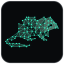</p>

<h1 align="center">RatLabs Mesh</h1>

<p align="center"><b>Drop in character art. Get back a finished, game-ready 3D model.</b><br>
Cut-out, 3D generation, cleanup, real-world sizing, review renders and auto-rigging in one local studio.</p>

<p align="center">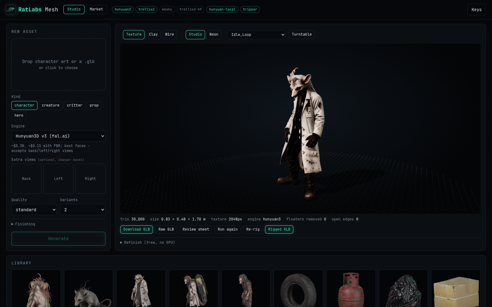</p>

---

## From one picture to a model you can ship

<table>
<tr>
<td width="30%" align="center">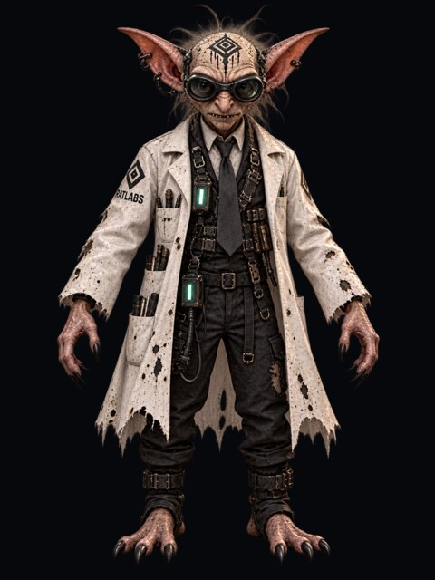<br><sub><b>In:</b> one piece of 2D art</sub></td>
<td width="70%" align="center">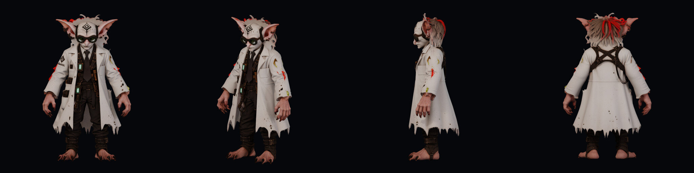<br><sub><b>Out:</b> a textured 3D model, shown front, ¾, side and back</sub></td>
</tr>
</table>

Image-to-3D models give you a raw mesh. That's maybe half the work. RatLabs Mesh does the rest of the
production chain for you, so the file you download can go straight into a game engine:

- **One clean mesh** with stray floaters removed and welded seams
- **The right triangle count**: ~30k for a character, 15k for a prop, 80k for a hero close-up
- **One 2K texture** with sensible PBR settings (no accidental chrome)
- **Real-world size**, with feet on the ground: a character is 1.7 m and a rat is 10 cm
- **Front / ¾ / side / back review renders**, so you can check a model without opening Blender
- **One-click rig + animate**: a 22-bone skeleton and 88 free CC0 animations (idle, walk, run, attack...)

## The studio

<p align="center">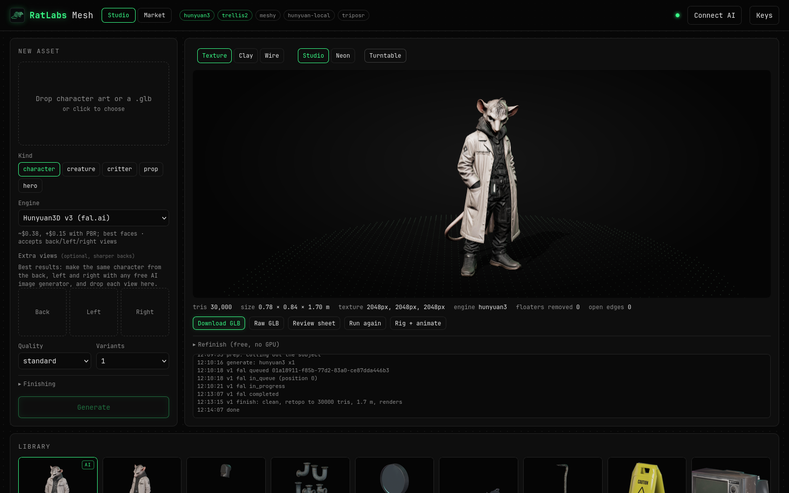</p>

Drop art on the left, pick what it is (**character, creature, critter, prop, hero**), and press **Generate**.
Everything you've made stays in the library along the bottom. Each model comes with its stats, downloads,
and a **Refinish** panel that re-sizes, re-budgets or turns the model around for free, with no GPU.

### Inspect every model three ways

| Texture | Clay | Wire |
|---|---|---|
| 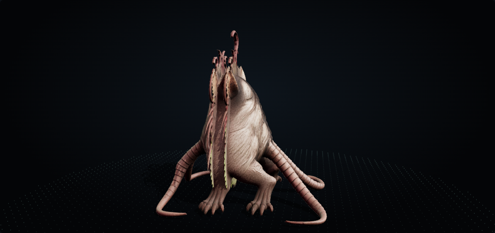 | 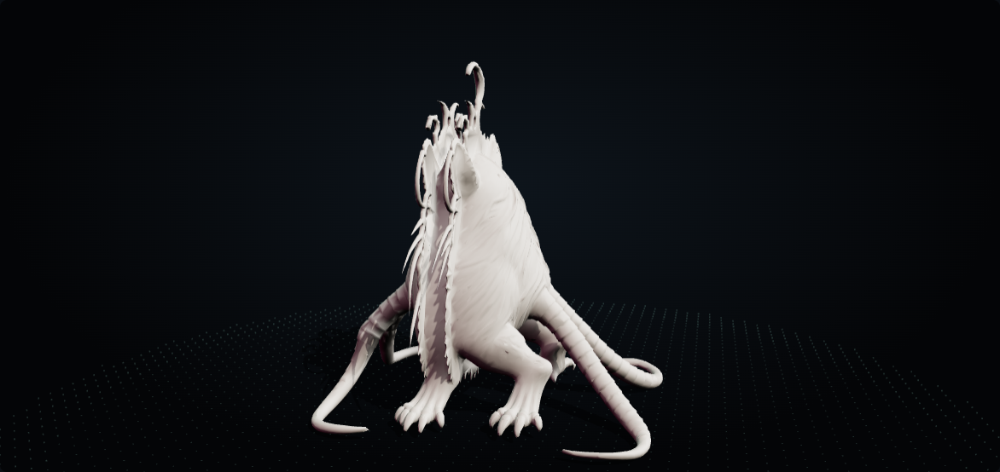 | 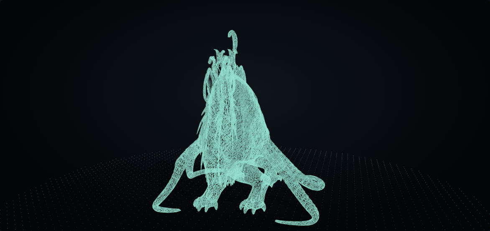 |

Clay mode shows the real shape without the paint. Wire mode shows the topology you're shipping. Flip
between **Studio** and **Neon** lighting to see how it holds up in a dark scene.

### Rigged and animated in the browser

<table><tr>
<td width="50%">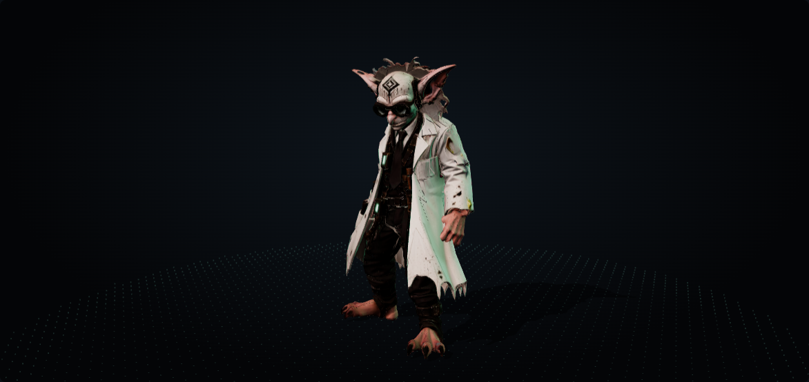</td>
<td width="50%">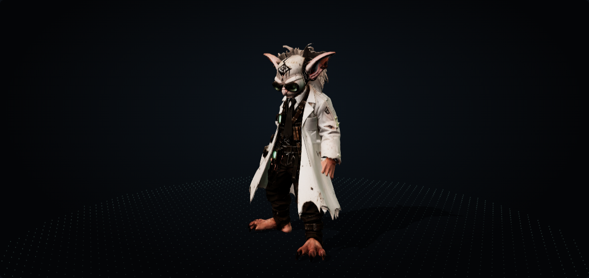</td>
</tr></table>

Press **Rig + animate** on any standing biped. Pick a clip from the dropdown to watch it move, then
download the rigged GLB.

### Market: free assets to fill the rest of the scene

<p align="center">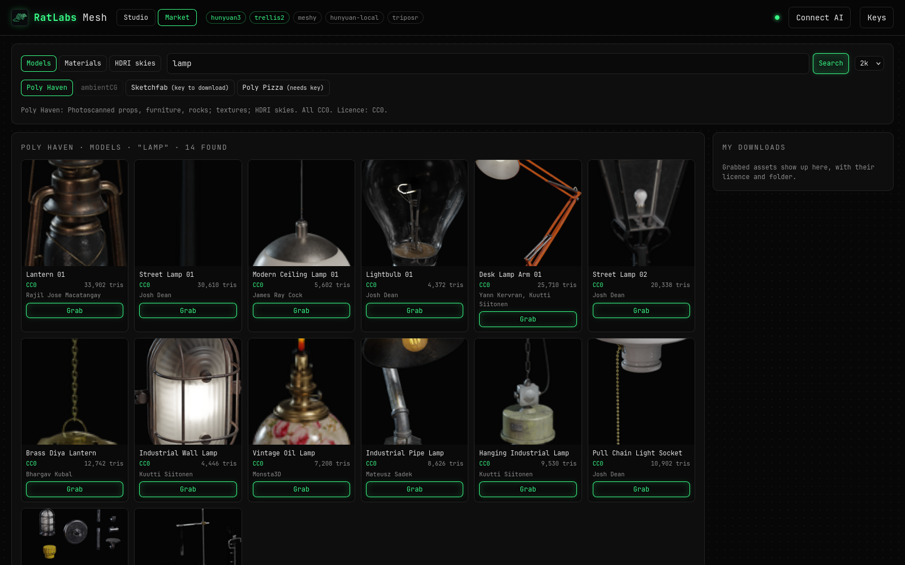</p>

One search across **Poly Haven**, **ambientCG**, **Sketchfab** and **Poly Pizza** for models, materials and
HDRI skies. Every download keeps its licence, author and source page next to it. Any model you grab can go
through the same finishing pipeline, so a scene full of mixed sources ends up at one consistent scale.

---

## Pick your engine

| Engine | Cost | Speed | Best for |
|---|---|---|---|
| **Hunyuan3D v3** (fal.ai) | ~$0.38 a model | a few minutes | Best faces. Takes back / left / right views for turnarounds |
| **TRELLIS.2** (fal.ai) | ~$0.25–0.35 | about a minute | Fast open-model drafts |
| **Meshy** | your Meshy plan | minutes | Reference quality; can force an A- or T-pose |
| **Hunyuan3D-2 local** | **free, fully offline** | ~25 min on a CPU | Nothing leaves your machine. No GPU needed |
| **TripoSR local** | free | ~90 s | Rough previews to check a cut-out and pose |

The local engine runs on a plain CPU (tested on Intel integrated graphics, no NVIDIA card). Remote
engines get only the prepared cut-out of your art; the local engine sends nothing anywhere.

---

## Get started

**You need:** Linux, [`uv`](https://docs.astral.sh/uv/), Blender and ImageMagick. Developed on Arch
([Omarchy](https://omarchy.org)).

```sh
git clone git@github.com:labrat-0/ratlabs-mesh.git
cd ratlabs-mesh
./ratmesh.sh serve          # first run builds the Python env, then open http://127.0.0.1:8771
```

Want it as a desktop app with a launcher icon? Run `./install.sh` instead. It adds a background service
and a **RatLabs Mesh** entry to your app launcher (`./install.sh --uninstall` removes both).

### Add an engine

- **Paid, fast:** click **Keys** in the top-right corner and paste a [fal.ai](https://fal.ai) key (and/or a
  Meshy key). Keys stay on your machine in `~/.config/ratlabs-mesh/keys.env`.
- **Free, offline:** run `./local/setup_hunyuan.sh` once. It downloads ~22 GB of model weights and needs
  ~16 GB of RAM while generating.

### Make your first model

1. **Drop your art** onto the *New asset* panel. If the art is a scene, drag a box around one character.
2. Click **Preview cut-out** to check the background was removed cleanly.
3. Choose a **Kind** (it sets height, triangle budget and texture size) and an **Engine**.
4. Press **Generate**. Two variants is the default; seeds differ a lot on backs and hands, so pick the better one.
5. **Download GLB**, or press **Rig + animate** first and take the rigged GLB.

### Tips for great results

- **One subject, whole body, facing front.** Arms slightly away from the body rig best.
- **Give it a back view** (with Hunyuan3D v3 or Meshy) when the back matters.
- **Use "hero"** for close-ups (80k triangles, 4K texture) and **"character"** for in-game models.
- Untick **Remove baked lighting** to keep the art's own dark, moody colour in the texture.
- Already have a GLB from somewhere else? Drop it in and RatLabs Mesh will just finish it.

### Prefer the command line?

```sh
./ratmesh.sh make art.png --kind character --engine hunyuan3 --variants 2
./ratmesh.sh make scene.png --crop 0.30,0.04,0.62,0.99         # one character out of a scene
./ratmesh.sh make front.png --back back.png --engine hunyuan3   # sharper backs from a turnaround
./ratmesh.sh import old.glb --kind prop                         # finish an existing model
./ratmesh.sh refinish <job-id> --polys 12000 --rotate 180       # free re-finish, no GPU
./ratmesh.sh rig <job-id>                                       # skeleton + 88 animations
./ratmesh.sh engines                                            # which engines are ready
```

---

## Under the hood

How each stage works, how it lines up with Meshy's pipeline, presets, engine setup and timings:
**[docs/TECHNICAL.md](docs/TECHNICAL.md)**.

**Licences.** The local engine uses Tencent's Hunyuan3D-2, under the Hunyuan 3D 2.0 Community License,
which allows commercial use under 1M monthly users but **does not cover the EU, UK or South Korea**.
Animations are CC0 (Quaternius). Market assets keep their own licences, saved with each download.

<p align="center"><sub>Built by <b>RatLabs</b> · <a href="https://ratlabs.tech">ratlabs.tech</a></sub></p>
